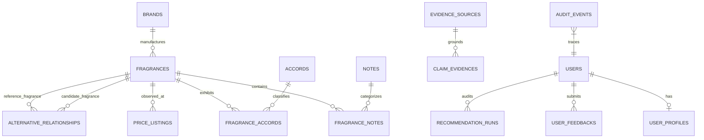
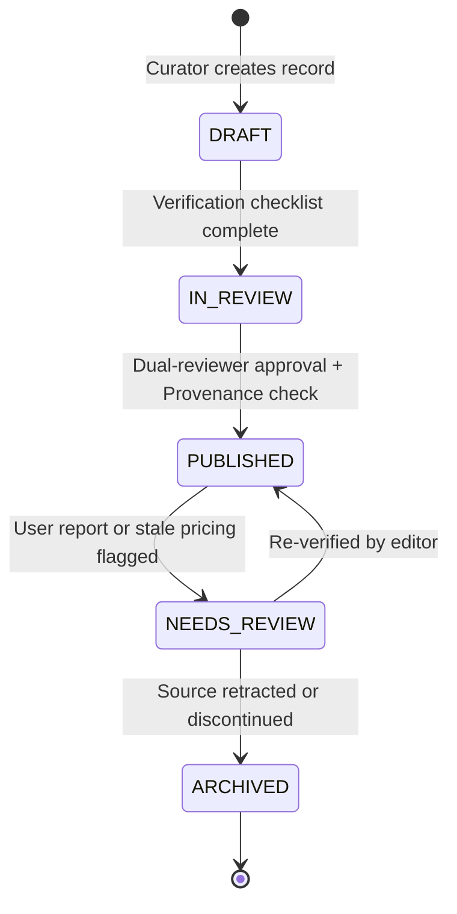

# SCENTIQ System Architecture Document

*Version 1.0 — Technical Baseline*

## 1. High-Level Architecture Overview

SCENTIQ is built as a **modular monolith inside a monorepo**, strictly following an **evidence-first, catalogue-grounded** engineering philosophy.

```mermaid
graph TD
    Client["Next.js Web Client<br/>(App Router, TypeScript, Tailwind)"]
    API["FastAPI Modular Application<br/>(Uvicorn, Python 3.12)"]
    
    subgraph Core Layer
        Auth["Security & Auth<br/>(JWT, Bcrypt, RBAC)"]
        Errors["Standard Error Envelopes<br/>(PRD 13.1 & 13.2)"]
        Logs["Structured Logger<br/>(Request-ID Correlation)"]
    end
    
    subgraph Service Layer
        CatSvc["Catalogue Service<br/>(State Transitions & Dupes)"]
        AltSvc["Alternative Service<br/>(Directed Graph & A/B/C Grades)"]
        CompSvc["Comparison Service<br/>(Note Diffing & Disclosures)"]
        RecSvc["Recommendation Engine<br/>(Deterministic Multi-Factor Scoring)"]
        EvidSvc["Evidence & Provenance Service<br/>(Claims & Rights Register)"]
    end
    
    subgraph Storage Layer
        PG[("PostgreSQL 16 / SQLite<br/>(SQLAlchemy 2.0 + Alembic)")]
    end
    
    Client -->|HTTPS / JSON Envelope| API
    API --> Core Layer
    API --> Service Layer
    Service Layer --> PG
```

---

## 2. Relational Domain Entity Relationship Diagram (ERD)



---

## 3. Curation Lifecycle State Machine (PRD Section 8.5)

Every public fragrance record and alternative relationship must transition through governed lifecycle gates:



### Publication Enforcement Rule
A fragrance or alternative link **cannot** transition to `PUBLISHED` if:
1. It lacks a valid canonical name or concentration.
2. It lacks at least one verified claim mapped to an `EvidenceSource`.
3. Its evidence source is marked `PROPRIETARY_RESTRICTED` without written licence.
4. An alternative relationship attempts to reference itself.

---

## 4. Deterministic Recommendation Engine (PRD Section 12.3)

Rather than delegating fragrance matchmaking to an unconstrained LLM, SCENTIQ computes recommendations deterministically:

$$\text{Score} = 0.30 \cdot F_{\text{scent}} + 0.18 \cdot F_{\text{notes}} + 0.15 \cdot F_{\text{occasion}} + 0.12 \cdot F_{\text{climate}} + 0.10 \cdot F_{\text{budget}} + 0.08 \cdot F_{\text{perf}} + 0.07 \cdot F_{\text{evidence}} - P_{\text{exclusions}}$$

- **Hard Exclusions**: If a fragrance contains any user avoid term in its notes, accords, or family, it is immediately discarded prior to scoring.
- **Budget Ceiling**: If user marks a hard budget limit, fragrances exceeding the lowest observed INR price are excluded.
- **Sample-First Trigger**: If composite fit score $< 0.70$ or if note pyramid is incomplete, the system prompts the user to order a decant sample before blind buying.
